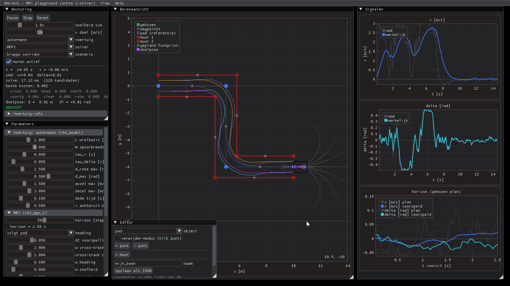

# No Cutting Corners

**Sampling-based model predictive control for small robot vehicles, in
dependency-free C — with a GUI that runs the same code the robot will.**

A path follower for an Ackermann-steered electric quad, a skid-steer platform,
a differential drive and a three-wheel holonomic robot. It models what the
actuators actually do — the speed loop lags, the steering servo has a rate
limit — so behaviour like braking before a corner is not programmed but falls
out of the model. One hard constraint runs through the whole design:

> **No external math libraries, no QP/NLP solver, no matrix inversion.**
> Only `sin`, `cos` and `tan`, so the same C compiles for the planning
> computer and for the microcontroller.

The full story, with measurements and the dead ends, is in the paper:
**[docs/paper_no_cutting_corners.md](docs/paper_no_cutting_corners.md)**
(or [the printable A4 version](docs/paper_no_cutting_corners.pdf)).



## What is in here

| Path | Contents |
|---|---|
| `src/mpc/` | The planner: vehicle models behind one interface, two solvers sharing one cost function, path smoothing. C11, nothing beyond `libm`, no allocation. |
| `test/native/` | Eight host test suites, 243 assertions. Behavioural: they drive the solver for tens of simulated seconds and check where the vehicle ends up. |
| `tools/viz/` | Python visualisation over `librbt_mpc.so` through ctypes — a Dear ImGui playground and a matplotlib scenario runner. Nothing is re-implemented in Python. |
| `tools/paper/` | Builds the PDF of the paper from its Markdown source. |
| `docs/` | The plan documents written before each phase (in Dutch, with the lessons learned kept in), and the paper. |

Two solvers share one cost function, which makes comparing them honest:

- **`rbt_mpc`** — a grid of constant-command candidates, scored and
  minimised. Deterministic, no random seed, so it is the one the regression
  tests pin numerically.
- **`rbt_mppi`** — Model Predictive Path Integral control: 256 time-varying
  rollouts sampled around the previous solution, combined by a softmax
  weighted average. This is the one that drives well.

Four vehicle types sit behind a single `rbt_model` interface of function
pointers plus a parameter table, so adding a vehicle needs no change in the
solvers and no change in the GUI.

## Build and test

Ubuntu 24.04, GCC and CMake. Nothing else for the C side.

```bash
cmake -B build-native -S . -DCMAKE_BUILD_TYPE=Release
cmake --build build-native -j
ctest --test-dir build-native --output-on-failure
```

8/8 suites pass in about 22 s; most of that is the docking suite, which
simulates 16 full approaches.

## The playground

```bash
python3 -m venv .venv
.venv/bin/pip install numpy matplotlib imgui-bundle
.venv/bin/python tools/viz/mpc_playground.py
```

Sliders are generated from each model's own parameter table, the map draws the
candidate bundle and the planned horizon, and the editor lets you drag walls
and waypoints and save a scenario as JSON.

The GUI loads `build-native/librbt_mpc.so` once at start-up, so **restart it
after rebuilding the C code**. *Help → Over* shows which library is actually
loaded — that line exists because an afternoon was lost to a stale one.

To regenerate the figures in the paper, and the paper itself:

```bash
.venv/bin/python tools/viz/make_paper_figures.py            # figures for the web
.venv/bin/python tools/viz/make_paper_figures.py --print    # figures at A4 size
python3 tools/paper/build_pdf.py                            # the PDF
```

Every figure is produced by driving the real solver, so a plot cannot drift
away from the code it describes.

## Status

The planner works in simulation and is tested there. Two things are still
open, both written up rather than hand-waved:

- **Robustness.** In simulation the plant *is* the model. On a real vehicle the
  slip factor varies with the surface and the time constants vary with battery
  charge. [`docs/robustness_rmppi_plan.md`](docs/robustness_rmppi_plan.md) plans
  the measurements first, then a fixed-gain correction between solver updates,
  and only then considers full RMPPI.
- **Real hardware.** Every actuator parameter here is an estimate until the
  step responses are measured on the physical vehicles.

## Background

This planner was written for the Omnibot project at Fontys ICT, and is also a
data point in a teaching question: what does good embedded-software education
look like when agentic AI tooling is in the room? Every line here was written
in agent sessions (Claude Code) directed by one lecturer. Section 9 of the
paper reports what that produced and, more usefully, the six behavioural
defects the agent did not find and a human driving the GUI did.

## Licence

**AGPL-3.0-or-later** — study it, use it, change it, and publish your changes
under the same terms, including when you run it as a network service. For
commercial use without those obligations, contact the copyright holder for a
separate licence. The documentation and figures in `docs/` are under
CC BY-SA 4.0, so colleagues can reuse them in teaching material with
attribution.

Edwin van den Oetelaar · Fontys ICT · research related to Lectoraat HTES
