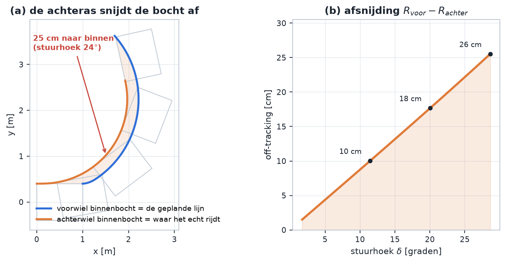
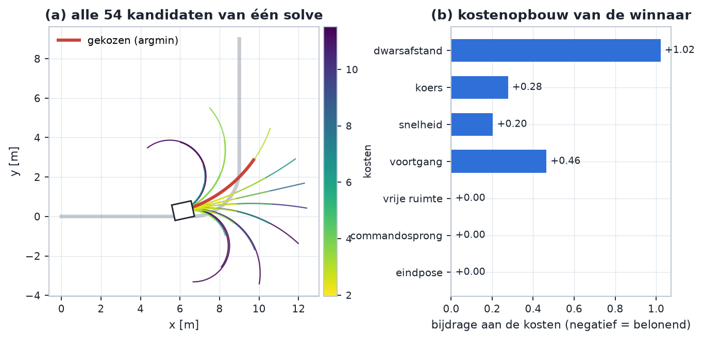
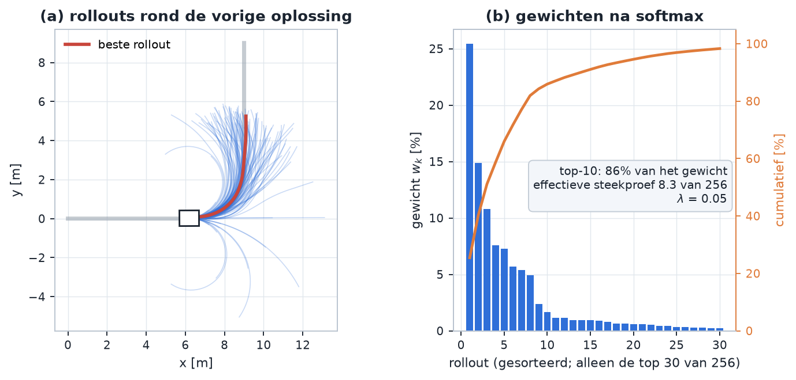
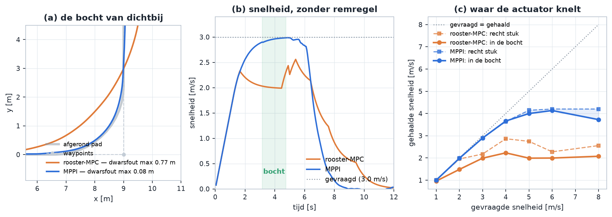
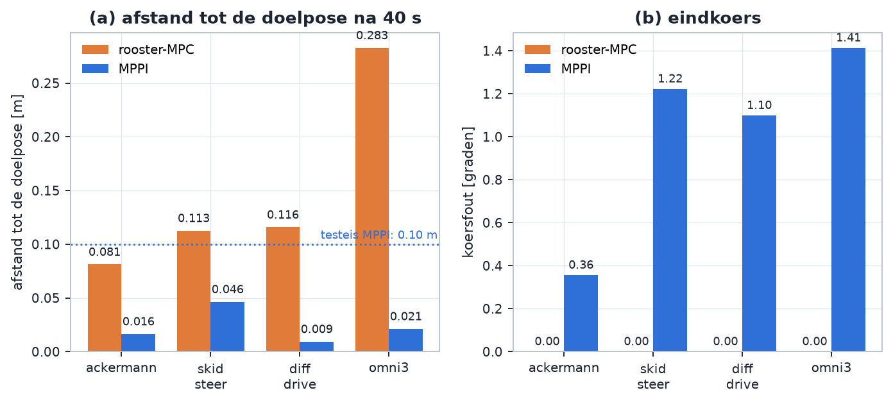
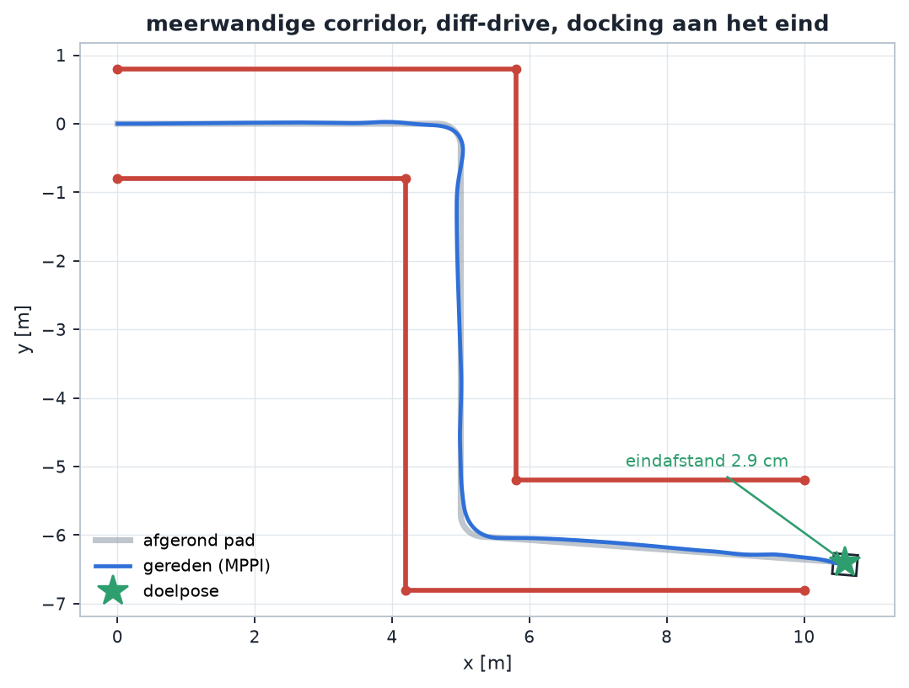
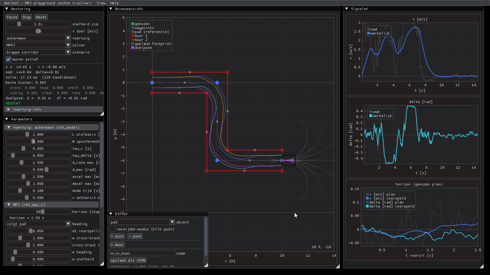

# No Cutting Corners

**A sampling-based model predictive controller for small Ackermann, skid-steer,
differential-drive and holonomic vehicles — written in dependency-free C,
verified on the host, and driven by a GUI that runs the same code the robot
will.**

**Edwin van den Oetelaar** · Fontys ICT · research related to Lectoraat HTES
Technical report, November 2026

Repository: <https://github.com/chat-l18l/no_cutting_corners_with_AI>

> Deze Markdown-versie is de bron. Om door te sturen of af te drukken is er
> [paper_no_cutting_corners.pdf](paper_no_cutting_corners.pdf) (A4, met
> inhoudsopgave en QR-code naar deze repo).
>
> Alle figuren komen uit de échte C-solver; de getallen in de tekst komen uit
> die run en uit `ctest`, niet uit het geheugen. Opnieuw opbouwen:
>
> ```bash
> .venv/bin/python tools/viz/make_paper_figures.py           # webfiguren
> .venv/bin/python tools/viz/make_paper_figures.py --print   # A4-figuren
> .venv/bin/python tools/paper/make_qr.py                    # QR-code
> python3 tools/paper/build_pdf.py                           # de PDF
> ```

---

## Samenvatting voor de groep

We hebben voor onze robotvoertuigen een eigen bewegingsplanner gebouwd: een MPC
die de *traagheid van de actuatoren* meeneemt (snelheidslag, stuurservo met
snelheidslimiet) en die daardoor vanzelf afremt waar dat moet, in plaats van dat
iemand een remregel programmeert. De bewuste beperking: **geen externe
wiskundebibliotheken, geen QP/NLP-solver, geen matrixinversies** — alleen `sin`,
`cos`, `tan`, zodat dezelfde C-code op de Orin én straks op de ESP32-P4 past.

Het resultaat zijn twee solvers (een deterministisch rooster en MPPI) die één
kostenfunctie delen, vier voertuigtypes achter één interface, muren/corridors, en
docking op 1–5 cm van de doelpose. Alles staat onder 243 host-tests in 8 suites,
en er is een ImGui-playground waarin je met schuifjes aan de échte C-code draait
— geen Python-nabouw. De hele repo is openbaar voor collega's en studenten.

Voor HTES is er een tweede verhaallijn: dit is gebouwd in agent-sessies met
Claude Code. Wat dat opleverde, en vooral *wat de agent zelf niet vond* — zes
gedragsfouten die pas zichtbaar werden toen een mens de GUI bediende — staat in
§9.

| Kerngetal | Waarde |
|------------------------------|-------------------------------------------|
| Planner-kern | 2 989 regels C |
| Tests | 243 assertions in 8 suites, alle groen |
| Rekentijd | 3.2 ms per MPPI-solve (256 rollouts, één core) |
| Docking | 0.9–4.6 cm, vier voertuigtypes |
| Externe wiskundebibliotheken | 0 |

---

## 1. Why not an off-the-shelf path follower

The vehicle is an electric quad: rear-wheel drive, Ackermann steering on the
front axle, an NVIDIA Orin AGX for planning and an ESP32-P4 for real-time
actuation, with Zenoh between them.

Pure pursuit and Stanley are the standard answers, and both are in the
literature we started from. They share an assumption we cannot make: that the
command you compute is the command the vehicle executes. On our quad the
steering servo has a rate limit of about 86°/s and the speed loop has a time
constant of 0.8 s. A controller that ignores this asks for a steering angle the
servo reaches a quarter of a second later, by which time the vehicle is
somewhere else. At 3 m/s that quarter second is 75 cm.

The usual fix is model predictive control. The usual MPC implementation then
reaches for a QP or NLP solver — acados, OSQP, CasADi — which means a
linear-algebra stack, a build-system problem on the MCU side, and a numerical
failure mode that is hard to explain to a student at 2 a.m. We set a hard
constraint instead: **no external math dependency, no matrix inversion**. Not for
purity — because the same code has to be reviewable, testable on a laptop, and
eventually small enough for the microcontroller layer.

That constraint has a well-known escape route. If you generate only
*physically achievable* input sequences, the constraints are satisfied by
construction and the optimiser degenerates into: simulate N futures, take the
cheapest. This is the Dynamic Window Approach [4] extended from one step to a
horizon, and it is the same family as MPPI [5,6], which replaces the fixed grid
of candidates with randomised ones and a softmax average. We implemented both.

## 2. The model, and the corner it cuts

State is the midpoint of the **rear axle**, plus the actual (not commanded)
speed and steering angle:

```
x'  = v · cos(θ)
y'  = v · sin(θ)
θ'  = (v / L) · tan(δ)                           L = wheelbase
v'  = (v_cmd − v) / τ_v                          first-order lag + dead time
δ'  = clamp((δ_cmd − δ) / τ_δ, −δ̇_max, +δ̇_max)   servo: rate-limited
```

Two of the three requirements fall out of these five lines. The actuator lag
*is* the model, so every simulated future already contains it. And "going faster
means having to steer sooner" needs no rule: curvature is `κ = tan(δ)/L`, the
curvature change available per metre travelled scales with `δ̇_max / v`, so at
high speed the simulated trajectory simply misses the corner and the cheapest
candidate is the one that slowed down earlier.

The third requirement is geometric. Referencing the rear axle makes off-tracking
free: `R_rear = L/tan δ` while `R_front = L/sin δ`, which is always larger. The
inner rear wheel runs inside the line the front wheel draws — **25 cm inside it
at full lock** in our geometry. For a vehicle operating next to a kerb, that
25 cm is the whole problem.



**Figure 1.** Off-tracking, simulated with the real C model. (a) A quarter turn
at 1.6 m/s with 24° of steering: the blue line is where a front-referenced
planner thinks the vehicle goes, the orange line is where the inner rear wheel
actually goes — 25 cm further in. (b) The same quantity from the closed-form
radii in `rbt_vehicle_model.c`. The cost function penalises the clearance of all
four wheel contact points, so the planner widens the entry by itself.

## 3. A solver that is not a solver

Each control cycle (20–50 Hz on the Orin) the grid solver builds a mixed-radix
Cartesian product over the command channels — for the quad, 6 speeds × 9 steering
fractions = 54 candidates — holds each command constant over a 2.5 s horizon
(50 steps of 50 ms), scores the resulting trajectory, and applies the first
command of the winner. Everything is a fixed-size array; there is no allocation
anywhere in the planner.

The scoring function is shared by both solvers, which is the single most useful
structural decision in the codebase: a fair comparison is then guaranteed, and a
cost-function bug cannot hide in one of them. Its terms are cross-track distance
(Huber-capped), heading error, speed against a reference, *progress* along the
path, corridor clearance with a hard crossing penalty, command-rate (comfort),
and terminal goal terms that blend in near the end of the path.

> **Why "progress" has to be a separate term.** Without it, stopping before a
> corner is a local optimum: standing still costs only a little speed penalty,
> while the reward for carrying on appears beyond the horizon. One term —
> `v_ref·dt − Δs` per step — removes the behaviour completely. It is the kind of
> defect that is invisible in a unit test and obvious within two seconds of
> watching the GUI.



**Figure 2.** One solve, fully inspectable. (a) All 54 candidates of a single
cycle approaching the corner, coloured by cost; the red one is the argmin that
gets applied. (b) The winner's cost broken down by term — the solver writes this
breakdown into its own struct every cycle, so both the GUI and the tests can
read it.

## 4. MPPI, and two lessons that cost a day each

The grid solver has a structural weakness: a command held constant for 2.5 s
cannot follow an arc whose curvature changes. MPPI removes that limit by sampling
*time-varying* sequences — 256 of them, as noise around the previous solution —
and taking a softmax-weighted average with weights `exp(−(c − c_min)/λ)`. Same
model, same cost function, same introspection buffers; about 350 lines of C,
including its own xorshift64\* generator and Box–Muller transform so that runs
are bit-reproducible.

1. **White noise is a speed tax.** Independent per-step steering noise jitters
   the trajectory, and the resulting cost penalty scales roughly with v². The
   weighted average then "learns" that driving slowly is cheap and sits far below
   the requested speed. AR(1)-filtered (coloured) noise fixes it.
2. **Anchor rollouts against local minima.** The first 22 rollouts are
   noise-free: the unperturbed mean plus a small grid of constant commands. They
   pay no noise tax when the cost landscape is sharp (a kerb), and they give MPPI
   the same escape route out of "stop before the corner" that the grid solver has
   for free.



**Figure 3.** MPPI at the same moment as Figure 2. (a) Rollouts sampled around
the previous solution — the first 128 of 256, which is as many as the
introspection buffer keeps. (b) After the softmax, ten of the 256 rollouts carry
86 % of the weight and the effective sample size is 8.3.

## 5. Results

### Braking in corners, without a braking rule



**Figure 4.** A 90° corner, filleted at 1.3× the minimum turning radius,
requested speed 3 m/s. (a) The grid solver slows down *and* still misses the line
by 0.77 m; MPPI holds the fillet to within 0.08 m. (b) The same run in time: the
grid drops to 2.0 m/s through the bend, MPPI barely slows. (c) Sweeping the
requested speed separates the two causes: dashed lines are what each solver
reaches on the straight, solid lines what it reaches in the bend. The gap between
them is genuine corner braking; for MPPI it only opens up above 5 m/s.

The honest version of "it brakes by itself" is: *it brakes when the actuator is
the binding constraint, and not before*. The grid solver hits that limit
immediately, because a constant command is a poor approximation of an arc; MPPI
hits it only when the servo genuinely cannot pre-steer fast enough. The grid
solver stays in the codebase as a deterministic reference — it has no random
seed, so it is the one we regression-test numerically.

### Docking, corridors, and four vehicles behind one interface

Reaching the end turned out to be its own project: the first version orbited the
goal (circling was cheaper than stopping), the second overshot and then crept
forward forever. The fix needed three pieces — a stop taper that respects what
the brakes can do (`v_ref ≤ √(2·a·s)`, because a linear ramp is infeasible
against the lag tail), terminal cost terms that blend in near the goal, and a
genuine reverse channel so a small overshoot can be corrected by backing up
instead of by pirouetting.



**Figure 5.** Docking accuracy after a 40 s run. MPPI parks within 0.9–4.6 cm
and 1.4°; the grid solver settles at 8–28 cm, the equilibrium you get when every
candidate is a constant command. Adding a vehicle to the registry automatically
adds it to this test.

The four vehicles — Ackermann, skid-steer (slip factor and coupled wheel-speed
limit), differential drive, and a three-wheel holonomic "omni3" with a proper
wheel-speed polytope — sit behind one `rbt_model` interface of function pointers
plus a parameter table. The GUI builds its sliders from that table, so a new
vehicle type arrives in the playground with no GUI code at all. Corridors are
flat buffers of polylines with one convention: the vehicle stays *left* of the
drawing direction.



**Figure 6.** Differential drive through a two-wall corridor, finishing 2.9 cm
from the goal pose. The clearance term is a hinge on distance to each wall
segment with a hard crossing penalty on top; all four wheel contact points are
checked.

### Cost of a solve

Measured on a 2017 i7-8550U laptop under WSL2, single-threaded, timing only the
C call. The unoptimised column is what the playground actually runs.

| Solve | −O0 median | −O3 median | −O3 p95 |
|---|---:|---:|---:|
| Grid, 54 candidates | 1.21 ms | 0.55 ms | 0.85 ms |
| Grid + 2-wall corridor | 2.25 ms | 0.91 ms | 1.03 ms |
| MPPI, 256 rollouts | 7.17 ms | 3.21 ms | 3.49 ms |
| MPPI + 2-wall corridor | 12.91 ms | 4.98 ms | 5.57 ms |

A 2.5 s horizon at 50 ms resolution for 256 rollouts costs 5 ms on one old
laptop core. The 20–50 Hz budget on the Orin is met with a factor of four to
spare before anyone touches the GPU.

### The playground



**Figure 7.** The playground drives the same `librbt_mpc.so` that the tests link
against — the rule from day one was that nothing gets re-implemented in Python.
Sliders are generated from the model's parameter table; the editor adds walls and
waypoints and saves scenarios as JSON. The status line shows live docking
distance and a green `GEDOCKT` when the test-suite criteria are met.

## 6. How we got here, step by step

Each step started with a plan document in `docs/` — Dutch, with checkboxes —
agreed before any code was written, and ended with the tests green and the GUI
driven by hand. The failures are listed because they are the interesting part.

1. **Plan and literature.** Kinematic bicycle with actuator dynamics, sampling
   instead of a solver, rear-axle reference for off-tracking.
2. **Vehicle model + host tests.** *Broke:* matplotlib silently fell back to a
   non-interactive backend under WSLg.
3. **Grid sampling solver.** *Broke:* stopping before every corner — fixed by the
   progress term.
4. **ImGui playground.** *Broke:* imgui-bundle 1.92 moved to the ImPlot3 API; the
   mouse cursor disappeared under WSLg until software-cursor rendering was
   enabled.
5. **MPPI alongside the grid.** *Broke:* the white-noise speed tax and the local
   minimum at standstill.
6. **Generic model interface, four vehicles.** *Broke:* a stride bug in the
   refactor (the rollout read commands with the wrong stride and got zeros from
   step 1), found by replaying the old solver against the new rollout and
   demanding bit-identical output. Then: omni3 crashed the GUI on a stale preview
   buffer; omni3 orbited the goal; Ackermann overshot and crept.
7. **Corridors, end pose, editor.** *Broke:* corners sharper than 90° stalled both
   solvers (fixed by splitting sharp corners and keeping a 1.3× radius margin); a
   wall dragged into the inside of a bend froze the vehicle (creep candidate +
   Huber cap); differential-drive docking shuffled dangerously (command bounds
   were not capped to the physical wheel speed).
8. **Robustness: measure before building.** Still deliberately only a plan — see
   §10 and `docs/robustness_rmppi_plan.md`.

## 7. Algorithms investigated

| Algorithm | Role | Outcome | Ref |
|---------------------|-----------------|------------------------------------------------|-------|
| Kinematic bicycle model | Vehicle model | **implemented** — adequate at our lateral accelerations | [1] |
| Dynamic / tyre-slip models | Vehicle model | rejected — tyre parameters we cannot measure, speeds we do not drive | [1] |
| Pure pursuit | Path tracking | rejected — no actuator lag, no constraints, no kerb awareness | [2,3] |
| Stanley controller | Path tracking | rejected — same reason; both kept as teaching baselines | [2] |
| Dynamic Window Approach | Local planning | **adopted in spirit** — sample only reachable inputs, extended to a horizon | [4] |
| Grid sampling MPC | Solver | **implemented** — `rbt_mpc`, deterministic reference | [4,7] |
| MPPI | Solver | **implemented** — `rbt_mppi`, the production solver | [5,6] |
| QP/NLP MPC (acados, OSQP, CasADi) | Solver | rejected — external linear algebra, build weight, opaque failure modes | [7] |
| State-lattice planners | Local planning | rejected — precomputed primitives plus graph search | [7] |
| Tube-MPPI / RMPPI | Robustness | **planned** — needs iLQR gains; "tube-lite" alternative first | [8,9] |
| Swept-path analysis | Clearance | **implemented** — all four wheel contact points scored | [10] |
| Fillet arc smoothing | Path preparation | **implemented** — plus sharp-corner splitting above 1.75 rad | — |
| Clothoid / Euler spirals | Path preparation | rejected — Fresnel integrals; fillets suffice at our radii | [7] |
| xorshift64\* + Box–Muller | Sampling | **implemented** — reproducible noise without libc `rand()` | — |

## 8. The repository

| Area | What it is | Lines |
|-----------------|--------------------------------------------------------------|------:|
| `src/mpc/` | Planner core: vehicle models, registry, both solvers, path smoothing (8 .c + 8 .h, C11, nothing beyond `libm`) | 2 989 |
| `test/native/` | Eight host test suites, one self-contained C program each | 2 146 |
| `tools/viz/` | ctypes binding, ImGui playground, scenario runner, figure generator | 2 514 |
| `tools/paper/` | The pipeline that turns the Markdown source into the PDF | 335 |
| `docs/` | Four plan documents (Dutch, with checkboxes and lessons learned) plus this paper | 1 007 |

The planner has **0.72 lines of test per line of implementation**, and the tests
are behavioural rather than structural: they drive the solver for 40 simulated
seconds and assert on where the vehicle ended up, how far it wandered after
arriving, and whether it crossed a wall. Several bounds are calibrated numbers —
measured first with a scratch probe, then frozen as a regression limit.

| Suite | Assertions | Covers |
|-------------------------------------------|-----------:|------------------------------------------------|
| `test_mpc` | 48 | Grid solver: tracking, corners, kerb clearance, settling, goal, sharp corners, wall pinch |
| `test_docking` | 48 | End-pose precision for every vehicle in the registry, two target speeds, anti-shuffle metric |
| `test_omni3` | 40 | Holonomic model, wheel polytope, heading modes |
| `test_skid_steer` | 35 | Slip factor, coupled wheel-speed limit, curvature-preserving scaling |
| `test_vehicle_model` | 24 | Step responses, rate limits, turning radii, wheel positions |
| `test_mppi` | 22 | Reproducibility, coloured noise, arrival without overshoot |
| `test_path` | 21 | Fillet smoothing, sharp-corner splitting, degenerate inputs |
| `test_model` | 5 | Registry integrity — every model answers every interface call |

### Getting it running

Ubuntu 24.04, GCC and CMake. Nothing else is required for the C side.

```bash
git clone https://github.com/chat-l18l/no_cutting_corners_with_AI.git
cd no_cutting_corners_with_AI
cmake -B build-native -S . -DCMAKE_BUILD_TYPE=Release
cmake --build build-native -j
ctest --test-dir build-native --output-on-failure
```

8/8 suites pass in about 22 s — most of it the docking suite, which simulates
16 full approaches.

For the playground and the figures in this paper:

```bash
python3 -m venv .venv
.venv/bin/pip install numpy matplotlib imgui-bundle
.venv/bin/python tools/viz/mpc_playground.py
.venv/bin/python tools/viz/make_paper_figures.py
```

The build in `build-native/` is what the Python side loads; **restart the
playground after rebuilding the C code**, because the shared library is loaded
once at start-up. *Help → Over* shows the path of the library actually loaded.

### Licence

Code under **AGPL-3.0-or-later**: study it, use it, modify it, and publish your
changes under the same terms — including when you run it as a network service.
Commercial use without those obligations needs a separate licence from the
copyright holder. Documentation and figures are under CC BY-SA 4.0 so colleagues
can reuse them in teaching material with attribution.

## 9. What this says about building software with an AI agent

Every line of the planner, its tests and its tooling was written in agent
sessions (Claude Code), driven by one lecturer — the author — who specified,
reviewed, broke and redirected. It was built between 4 and 12 July 2026; in
`src/mpc/` alone, 3 344 lines were added and 355 deleted, measured in the
version history of the project this code was extracted from.

Three things worked, and are worth copying:

- **A plan document before each phase**, listing references and explicit
  "out of scope" items. It forces the architectural argument to happen in prose,
  where it is cheap to lose, instead of in code.
- **Host-native TDD.** Pure C modules with no hardware dependency meant every
  behaviour claim could be checked in under a second. The test suite is what made
  moving four vehicles behind one interface survivable.
- **Measure before you encode.** Several test bounds were set by running a
  scratch probe first and freezing the measured value. Numbers invented to make a
  test pass are worse than no test.

And the honest other half: **every behavioural defect in this project was found
by a human driving the GUI, not by the agent.** The omni3 crash on model switch,
the orbiting goal, the eternal creep, the stall at corners sharper than 90°, the
freeze next to a wall dragged into a bend, the dangerous shuffle when a
differential drive docked — six distinct failures, all with a green test suite at
the time. They share a shape: each is a *behaviour* that only exists in the
closed loop over many seconds, in a situation nobody thought to write a test for.

The seventh one is the most instructive, because it was not a defect at all.
After a fix, the problem appeared to persist in a screenshot — but the GUI had
been running since before the rebuild and still had the old shared library in
memory. **When a human and an agent debug together, make the tool state what it
actually loaded.** The about box now prints the path of the library in memory,
and that one line removes an entire class of mutual confusion.

Where this lands for teaching: the agent reliably produces structure, tests,
documentation and consistency across a multi-file C codebase at a rate no student
can match. It does not produce the suspicion that makes someone drag a wall into
a bend to see what happens. If that is the skill that survives, our exercises
should be built around it.

## 10. What is next

**Robustness.** In simulation the plant *is* the model, so every result above is
measured with a perfect model. On the real vehicle the slip factor varies with
the surface, the time constants vary with battery charge and load, and there is
network jitter between the Orin and the ESP32-P4. RMPPI [9] (and Tube-MPPI [8])
is the published answer: optimise around a nominal trajectory, hold the real
state to it with an ancillary feedback controller, and select the nominal state
by a free-energy criterion. Its ancillary controller wants iLQR gains — the
linear algebra we have avoided. `docs/robustness_rmppi_plan.md` therefore does
the measurement first: a disturbance harness (parameter mismatch, process noise,
command latency, dropped packets), a baseline degradation sweep, then a
fixed-gain "tube-lite" correction around the planned trajectory at MCU rate. Only
if that demonstrably falls short does full RMPPI get built, as a documented
exception, on the Orin and never on the microcontroller.

**Real hardware.** Every actuator parameter in this paper is an estimate. Phase F
of the plan is step-response measurements on the physical quad and the
Jackal-like platform, feeding measured τ, δ̇_max and slip values back into the
parameter tables.

## 11. References

1. J. Kong, M. Pfeiffer, G. Schildbach, F. Borrelli. *Kinematic and Dynamic
   Vehicle Models for Autonomous Driving Control Design.* IEEE Intelligent
   Vehicles Symposium, 2015.
2. J. M. Snider. *Automatic Steering Methods for Autonomous Automobile Path
   Tracking.* CMU-RI-TR-09-08, Carnegie Mellon University, 2009.
3. R. C. Coulter. *Implementation of the Pure Pursuit Path Tracking Algorithm.*
   CMU-RI-TR-92-01, Carnegie Mellon University, 1992.
4. D. Fox, W. Burgard, S. Thrun. *The Dynamic Window Approach to Collision
   Avoidance.* IEEE Robotics & Automation Magazine, 1997.
5. G. Williams, P. Drews, B. Goldfain, J. M. Rehg, E. A. Theodorou. *Aggressive
   Driving with Model Predictive Path Integral Control.* IEEE ICRA, 2016.
6. G. Williams et al. *Information-Theoretic MPC for Model-Based Reinforcement
   Learning.* IEEE ICRA, 2017.
7. B. Paden, M. Čáp, S. Z. Yong, D. Yershov, E. Frazzoli. *A Survey of Motion
   Planning and Control Techniques for Self-Driving Urban Vehicles.* IEEE
   Transactions on Intelligent Vehicles, 2016.
8. G. Williams et al. *Robust Sampling Based Model Predictive Control with Sparse
   Objective Information.* Robotics: Science and Systems, 2018.
9. M. Gandhi, B. Vlahov, J. Gibson, G. Williams, E. A. Theodorou. *Robust Model
   Predictive Path Integral Control: Analysis and Performance Guarantees.* IEEE
   Robotics and Automation Letters, 2021.
10. R. Rajamani. *Vehicle Dynamics and Control*, 2nd ed., Springer, 2012.
    Chapter 2: Ackermann geometry and off-tracking.
